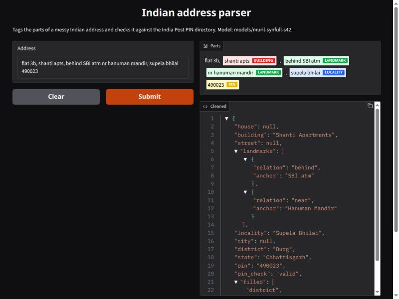

# Indian Address Parser: Parsing and Normalising Messy Indian Addresses

**Group 10** · DSL504 (Natural Language Processing) · IIT Bhilai · Oct–Nov 2026
Agastya Nath · Y. Rahul Dev Reddy · Paritosh Lahre · Varun Rao
Report content collected on 16 Nov 2026 (submission deadline: 16 Nov 2026, 5 pm IST)

> **How to read this file.** It collects the content for the report and the slides. Every number is copied from a
> results file in `results/`, mostly through the tables that `scripts/make_tables.py` builds from them
> (`report/tables/`, regenerated on 16 Nov 2026), and matches a row of the run table in `logs.md`. Appendix A lists the
> run behind each table. The human-written test set was not collected before the deadline, so **no number in this
> report is measured on real data.** Real-style numbers come from a 20-address smoke set (§4.3) and are labelled as such.

**Key numbers at a glance**

| | Synthetic dev (2,000 addresses) | hand20 (20 hand-written addresses) |
|---|---|---|
| Rules + gazetteer (no training) | – | 0.828 span F1 |
| CRF | 0.992 | 0.796 |
| XLM-R, fine-tuned | 0.991 | 0.759 |
| MuRIL, fine-tuned (the demo model) | 0.991 | 0.741 |
| Best existing open parser (abr-6024, 1.5B) | – | 0.645 field F1 |

---

## Abstract

Indian addresses are written with landmarks ("behind SBI ATM"), abbreviations ("b'lore-68"), Hinglish ("hanuman mandir
ke paas"), free word order and missing commas. We tag nine address fields (house, building, street, landmark,
locality, city, district, state, PIN) as BIO spans and normalise them against the India Post PIN directory (157,126
post offices, 19,300 PINs). We built a synthetic address generator with eight switchable noise families; a rules
baseline, a CRF, and fine-tuned MuRIL and XLM-R taggers; zero-shot runs of five existing open Indian-address parsers
and a few-shot LLM; a PIN normaliser; an evaluation harness with bootstrap confidence intervals and paired
comparisons; annotation tooling for a human-written test set; and a demo. Trained on 20,000 synthetic addresses, the
CRF, MuRIL and XLM-R reach 0.991–0.992 span F1 on synthetic dev data, but only 0.741–0.796 on 20 hand-written
public-place addresses, where a rules baseline scores 0.828. On those 20 addresses every one of our systems still beats
every existing open parser (paired bootstrap; all 28 intervals above zero). The planned human-written test set was not
collected, so the research questions remain open; the pipeline that answers them is built and tested.

## 1. Introduction

### 1.1 The problem
Indian addresses rarely follow a fixed format. They lean on landmarks, abbreviations, mixed scripts, transliterated
words and free ordering, often with missing commas:

    opp. ganesh temple, 2nd cross, behind old bus stand, hosur road, madivala, b'lore-68

Delivery, banking KYC and emergency services all need these as structured fields. India Post's DIGIPIN (2025) gives
every ~4 m × 4 m grid cell a 10-character code, but people will keep writing free-text addresses with landmarks, so
turning text into structured fields still matters. (This last point is our own argument, not a cited claim.)

### 1.2 What we built
1. **Tagger:** labels each token with an address field (§3).
2. **Normaliser:** cleans the fields and checks them against the India Post PIN directory (§5.7).
3. **Demo:** paste an address, get coloured tags, clean JSON and PIN warnings (§9).

Target output for the running example (illustrative; the PIN directory maps 490023 to Supela Bhilai, Durg,
Chhattisgarh):

    Input:  flat 3b, shanti apts, behind SBI atm nr hanuman mandir, supela bhilai 490023
    Tags:   HOUSE=flat 3b · BUILDING=shanti apts · LANDMARK=behind SBI atm · LANDMARK=nr hanuman mandir
            LOCALITY=supela · CITY=bhilai · PIN=490023

```json
{"house": "Flat 3B", "building": "Shanti Apartments",
 "landmarks": [{"relation": "behind", "anchor": "SBI ATM"},
               {"relation": "near", "anchor": "Hanuman Mandir"}],
 "locality": "Supela", "city": "Bhilai", "district": "Durg", "state": "Chhattisgarh",
 "pin": "490023", "pin_check": "valid"}
```

### 1.3 Research questions
The closest prior work (§2) already showed that parsers trained on clean synthetic data collapse on real text. Our
focus is what it leaves open:

- **RQ1 (the gap):** how much do parsers trained on synthetic data, both ours and existing open models, lose on real
  human-written addresses?
- **RQ2 (which noise helps):** which kinds of synthetic noise (§4.2) close the gap most?
- **RQ3 (real data):** how much does adding a few real labelled addresses (0 / 25 / 50 / 100 / 200) help, compared
  with more synthetic data?
- **Secondary:** how many errors does PIN-directory normalisation catch or fix?

Hypotheses: **H1** everything trained only on clean synthetic data drops sharply on real text, worst on STREET,
LOCALITY and LANDMARK; **H2** landmark and abbreviation noise give the biggest gains, and transliteration noise matters
mostly for code-mixed addresses; **H3** about 100 real examples help more than doubling the synthetic data.

### 1.4 Contributions
1. A synthetic address generator built on real geography, with eight noise families that can each be switched off
   (`src/generate/`).
2. One evaluation harness for very different systems: BIO taggers, existing taggers with other label sets, and
   JSON-output generators, compared on shared labels by explicit fairness rules (`src/eval/`, `scripts/make_tables.py`).
3. Baselines and models: rules, CRF, MuRIL, XLM-R; five existing open parsers and an LLM run zero-shot or few-shot.
4. A PIN-directory normaliser that validates and fills district and state (`src/normalize/`).
5. A complete, privacy-aware annotation pipeline for a human-written test set of public-place addresses
   (`data/real/GUIDELINES.md`, `data/real/labelstudio_config.xml`, `src/annotate.py`).
6. Preliminary results on synthetic data and a 20-address smoke set (§7), and a demo (§9).

## 2. Related work

**Closest work: Dhavase & Chaudhary (2026), ETASR.** They train IndicBERT, MuRIL, DeBERTa-v3 and XLM-R (3 seeds each)
on 15,000 grammar-generated (PCFG) addresses with no misspellings, abbreviations or shorthand. Their labels are
HOUSE, ROAD, SUBURB, CITY, STATE, POSTAL CODE and COUNTRY, with **no landmark label**. Their "real-world" test set is
500 addresses built from OpenStreetMap and noised by a script. All four models score 0.989–0.995 F1 on synthetic test
data and then collapse on that test set (XLM-R, mean of 3 seeds: HOUSE 0.006, ROAD 0.011, SUBURB 0.162, CITY 0.508,
STATE 0.671, POSTAL CODE 0.629). Their fix is retrieval at prediction time: each predicted span is embedded (MiniLM),
matched against OSM place names in a FAISS index and relabelled if close enough. They name descriptive spatial
language, vernacular landmarks, and mixing synthetic with small amounts of real data as open problems.

**Existing open Indian-address models** (our zero-shot baselines; all on Hugging Face):

| Model | Base | Output fields | Licence |
|---|---|---|---|
| `shiprocket-ai/open-indicbert-indian-address-ner` | IndicBERT | 11 fields incl. landmarks, locality, sub_locality | Apache-2.0 (card) |
| `shiprocket-ai/open-tinybert-indian-address-ner` | TinyBERT | same 11 fields | Apache-2.0 |
| `mukuls9971/muril-indian-address-ner-v1` | MuRIL | exactly our nine labels | none stated |
| `gagan1985/tinybert-4l-312d-indian-address-parser` | TinyBERT 4L-312D | 13 fields incl. poi, village, subDistrict | Apache-2.0 |
| `abr-6024/indian-address-parser-1.5B` | ~1.5B generative LM | JSON: flat, building, street, landmark, area, city, state, pincode, phone | Apache-2.0 |

A sixth model (`howdoiuse-keyboard/indian-address-parser-model`) was left out: its weights are pickle-only and its
config names no architecture, so it cannot be loaded without its author's code.

**Other work.** deepparse (Yassine et al. 2020) is a seq2seq parser trained on 20 countries, zero-shot for India,
with no landmark or locality tag. libpostal is a CRF with large dictionaries, strong on Western formats. Industry work
on Indian addresses (GeoIndia, EMNLP 2024 Industry; Mangalgi et al. 2020; Babu et al. 2017; Swamy et al. 2025)
keeps its data private. LLM approaches include AddrLLM (KDD 2025) and recent address-parsing studies (arXiv
2601.18014; arXiv 2404.05632). We found no public dataset of real, human-written Indian addresses with span labels.

**How we differ**

| | ETASR 2026 | Open HF models | Ours |
|---|---|---|---|
| Training data | Grammar-generated, no noise | Synthetic, mostly undisclosed | Generator with each noise family switchable and ablatable |
| Test data | OSM + noising script | Their own synthetic splits | Human-written public-place addresses, agreement-checked (designed; §4.4) |
| Landmarks | No label | Some have one | LANDMARK label + relation normalisation |
| Fix for the gap | Retrieval at prediction time | – | Better synthetic data + a little real data |
| Normalisation | – | One adds district/state from a PIN gazetteer | PIN-directory validation and filling |

## 3. Task and label schema

Each address is split into tokens (whitespace, and every punctuation mark its own token; one shared tokenizer,
`src.data.tokenize`) and each token gets a BIO (IOB2) tag over nine labels:

| Label | Covers | Examples |
|---|---|---|
| HOUSE | house / flat / plot / door / shop number, floor | `Flat 3B`, `H.No. 12/3`, `D.No 5-6-7/A`, `#12`, `2nd floor`, `Shop No. 4` |
| BUILDING | apartment, society, complex, named building, tower or block inside a society | `Shanti Apts`, `Sunshine Enclave`, `Tower C` |
| STREET | road, street, lane, cross, main, gali, marg, highway | `MG Road`, `2nd cross`, `Gali No. 4`, `NH 44` |
| LANDMARK | relation word + the landmark itself | `near Hanuman Mandir`, `opp. petrol pump`, `SBI ATM ke paas` |
| LOCALITY | area, colony, nagar, sector, layout, village, sub-locality | `Supela`, `Sector 21`, `Koramangala 4th Block` |
| CITY | city or town, in any spelling | `Bhilai`, `B'lore`, `Hyd` |
| DISTRICT | district, only next to a cue word (`Dist`, `Distt`, `District`, `Zila`) | `Durg` in `Distt. Durg`; a bare `Durg` is CITY |
| STATE | state or UT, including short forms | `Chhattisgarh`, `C.G.`, `MH` |
| PIN | 6-digit PIN, spaced or partial | `490023`, `490 023`, `68` in `b'lore-68` |

**Span rules** (`initials.md` §4, `data/real/GUIDELINES.md`):
- Cue words belong to the span: `near` / `opp.` / `behind` to LANDMARK, `Flat` / `H.No.` to HOUSE, `Road` / `Gali` to
  STREET, `Nagar` / `Sector` to LOCALITY, `Apts` / `Society` to BUILDING.
- Words that only announce a field (`Pin:`, `Dist.`, `State:`), filler (`c/o`, `India`), punctuation, names and phone
  numbers are `O`.
- **The place's own name is `O`** (`Shree Sweets`, `IIT Bhilai`): the form asks for it separately, and the generator
  prefixes one to every address, so it is not a difference between synthetic and real data.
- Each relation word opens a new LANDMARK span (`behind SBI atm` / `nr hanuman mandir`); sub-locality is merged into
  LOCALITY because the boundary is too fuzzy to annotate consistently.

Transformer models label the first subword of each token; later subwords are ignored by the loss (`-100`).

## 4. Data

### 4.1 Gazetteer: the India Post PIN directory
The All India Pincode Directory (data.gov.in, GODL-India licence), downloaded from the `dropdevrahul/pincodes-india`
mirror: 157,126 offices, 19,300 PINs and 36 states (committed as `data/raw/pincode.csv`; cleaned copy in
`data/gazetteer/pincodes.csv`). Cleaning:
- a 36-row canonical state table, so `C.G.`, `CG` and `Chattisgarh` all map to Chhattisgarh;
- CITY from the postal division name minus "Division" and trailing direction words (`Mumbai City North West` →
  `Mumbai`), or from the town that several office names in a district end in (`Supela Bhilai` → locality `Supela`,
  city `Bhilai`);
- 1,168 of the 19,300 PINs cover several districts; the normaliser accepts any of them and fills none;
- a `Test Office` row at PIN 999999 and army post offices at 9000xx are ignored (a PIN must start with 1–8).

Three parts use it: the generator (real geography), the rules and CRF (features), and the normaliser.

### 4.2 Synthetic generator
The generator (`src/generate/`) fills address templates with real geography from the PIN directory. Labels come for
free because it knows every span. Every address starts with a place name tagged `O`.

**Clean config:** all nine fields in one fixed order, commas, full words, one plain `near X` landmark.

**Noise families** (each transformation belongs to exactly one family, so a family can be switched off cleanly):

| ID | Noise family | Transformations |
|---|---|---|
| N1 | Abbreviations | `Road→Rd`, `Apartments→Apts`, `Sector→Sec`, `near→nr`, `opposite→Opp`, `District→Distt`; city short forms (`B'lore`, `Hyd`); state codes (`CG`, `C.G.`, `MH`) |
| N2 | Landmark phrases | relation variety (`opposite / behind / beside / next to / in front of / adjacent to / back side of`); Hinglish postpositions (`X ke paas / ke samne / ke peeche`); 0, 1 or 2 landmarks |
| N3 | Reordering and dropped fields | drop house / building / street / district / city / locality / state (p = 0.2 each; never the PIN or the place name); landmarks first, city ↔ locality, full shuffle |
| N4 | Delimiters and case | separators `, ` / space / ` - ` / ` / `; all lower / ALL CAPS / Title Case |
| N5 | Typos | one or two character edits (insert, delete, substitute, swap) in words of 4+ letters; never in the PIN |
| N6 | Spelling variants | `Mandir→Mandeer`, `Gali→Galli`, `Chowk→Chauk`, `Station→Steshan`, `ke paas→ke pass` (no Devanagari) |
| N7 | PIN variants | `490 023`, `490-023`, `Pin: 490023`, PIN before the state, `Bhilai-23`, PIN missing |
| N8 | Indian number formats | `#12`, `H.No 12/3`, `D.No 5-6-7/A`, `Door No 12`, `Flat No. 3B`, `Plot No 7/2`, `Khasra No 12` |

Families apply in the order N2, N3, N8, N7, N1, N6, N5, N4 (structure, then wording, then typos, then case and
delimiters). On the `full` config (all eight families) each family fires on 50–98 % of addresses and every label
survives in about 80 % of them. Configs: `clean`, `full`, `full-minus-Nx` (ablation, E3) and `only-Nx`.

**Splits:** PINs are split 90/5/5 into train/dev/test pools with a fixed seed, so dev and test addresses always use
held-out PINs. Each config has 20,000 train, 2,000 dev and 2,000 test addresses (data seed 42). The `clean` and
`full` sets are committed in `data/synthetic/`. The generator is deterministic: `full` regenerated on a second machine
is byte-identical to the committed copy (`logs.md`, 16 Nov).

**Known gap:** place, landmark and building names still come from short hand-written lists (20–40 items each); OSM
names were planned but not added.

### 4.3 hand20: the smoke set
`tests/fixtures/handlabelled20.jsonl` holds 20 hand-written addresses of public places with gold tags and slice
tags. 17 are from Bhilai, Durg and Raipur, and one each from Bengaluru, Madurai and Mumbai; one is written in
Devanagari. 17 of the 20 start with the place name. Slices: abbreviations 9, landmark 7, no PIN 4, and one each of ALL
CAPS, code-mixed, Devanagari, no commas and typo. Gold spans per label:

| HOUSE | BUILDING | STREET | LANDMARK | LOCALITY | CITY | DISTRICT | STATE | PIN | Total |
|---|---|---|---|---|---|---|---|---|---|
| 4 | 3 | 11 | 7 | 17 | 20 | 3 | 13 | 16 | 94 |

**Caveat:** hand20 was written by the team and used during development. For example, the generator's city names were
changed after the CRF tagged `Bhilai` as LOCALITY in 10 of the 20 items (`initials.md` §13, 10 Nov). It is a smoke
set, not a held-out test set, and its scores are probably optimistic, most of all for the rules.

### 4.4 Real human-written data (designed, not collected)
The headline evaluation was meant to use a new human-written test set (`initials.md` §5.3):
- **Collection:** a Google Form asks classmates and friends for the address of a **public place** (a shop, temple,
  college, hospital or office) written as they would for a courier. It asks for the place's name, the free-text
  address, then PIN, city and state in separate boxes (the true values for scoring the normaliser). No home addresses,
  names, phone numbers or emails; each response gets a respondent code. Five places per person, in different towns.
- **Target:** about 500 addresses: 250 test, 50 dev and a 200-address real-train pool for RQ3 (minimum: 200 / 50 / 50).
- **Splitting:** by respondent, before anyone reads the addresses, so one person's style never sits on both sides
  (`src/annotate.py tasks`, saved in `data/real/splits.json`).
- **Annotation:** Label Studio with the guidelines in `data/real/GUIDELINES.md`. Two people label the same 50 dev items
  first and report agreement (span F1 and token-level Cohen's κ; `src/annotate.py agreement`).
- **Privacy:** the raw export and the Label Studio task files are kept out of git until they are screened
  (`.gitignore`, 16 Nov).

**Status:** the form was not sent, so no real addresses were collected by the deadline.

## 5. Systems

| ID | System | Details |
|---|---|---|
| B0 | Rules + gazetteer | `src/models/rules.py` |
| B1 | CRF | `src/models/crf.py`, sklearn-crfsuite |
| M1 | MuRIL, fine-tuned | `google/muril-base-cased` (commit `afd9f36`), the main model |
| M2 | XLM-R, fine-tuned | `FacebookAI/xlm-roberta-base` (commit `e73636d`) |
| Z | Existing open parsers, zero-shot | four taggers and the abr-6024 generative parser (§2), pinned commits |
| L1 | Few-shot LLM | `Qwen/Qwen2.5-1.5B-Instruct` (commit `989aa79`) |
| – | Normaliser | `src/normalize/` |

### 5.1 B0: rules + gazetteer
Splits the address at commas and labels each chunk. It finds PINs with a regex (six digits, or 3 + 3), opens a
LANDMARK span at every relation word (`near`, `nr`, `opp`, `behind`, `beside`, …, or a Hinglish postposition after
`ke`), and uses cue-word lists for district, village, house, street, building and locality. State aliases, and
city, district and office names under the address's PIN, come from the gazetteer. It is deliberately simple: the
floor the learned models must beat.

### 5.2 B1: CRF
Linear-chain CRF (L-BFGS, c1 = c2 = 0.1, 100 iterations). Features per token: the lower-cased word, prefixes and
suffixes, word shape, digit and PIN-like flags, case, the cue-word lists of B0, gazetteer membership (office, city,
district and state words), a state-alias flag, and the same features for the two words on each side.

### 5.3 M1 and M2: fine-tuned transformers
Token classification with the first subword of each token labelled. Settings fixed once on synthetic dev (§7.5) and
reused for every run: 3 epochs, learning rate 1e-4, batch 32, linear warm-up over 10 % of steps, weight decay 0.01,
gradient clipping 1.0, bf16 mixed precision on the GPU, maximum length 256. Trained on synthetic `full` (20,000
addresses), seed 42, on an RTX 4060 Laptop GPU (8 GB). The MuRIL model used in the demo (237M parameters, 197,285-word
vocabulary) was saved on 16 Nov. It is too big for git (948 MB) and is public on Hugging Face as
`sandstromPL/muril-indian-address-parser` (tag `v1`).

### 5.4 Z: existing open parsers, zero-shot
Each model reads the raw text as its model card does, and a token of ours takes the label of the first subword that
overlaps it. Each tagger's labels are mapped onto ours (e.g. Shiprocket `house_details` and `floor` → HOUSE,
`locality` and `sub_locality` → LOCALITY), and it is scored only on the labels it shares with us. The abr-6024 model
answers in JSON, so it is scored at field level only; its `city` key holds a district or a metro name, so it counts as
our CITY or DISTRICT.

### 5.5 L1: few-shot LLM
The base model the abr-6024 parser was fine-tuned from, prompted in our nine labels and asked to copy each piece of
the address exactly as written, as JSON. Two variants: 5 examples drawn with seed 42, and 0 examples. Greedy
decoding. In the plan the examples come from the real-train pool; with no real data, the 5 examples were drawn from
synthetic `full` train as stand-ins.

### 5.6 Not built
B2 (a BiLSTM-CRF) was optional and was not built. deepparse and libpostal were not run.

### 5.7 Normaliser
`pin_check` is one of `valid`, `mismatch`, `not_found` or `missing`. A mismatch is reported only when the written
state or district contradicts the directory; a misspelt state or district (string similarity ≥ 0.8) is not a
mismatch. District and state are filled in from the PIN only when the check is `valid` and the PIN has one district.
Abbreviations are expanded by the inverse of the N1 table (`Apts` → `Apartments`), landmarks are split into relation
and anchor, and a locality that is not an office under the PIN is flagged (`locality_known`), not counted as an error.

## 6. Evaluation

- **Main metric:** entity-level micro and macro F1 with `seqeval` in strict IOB2 mode, reported per label.
- **Field-level P / R / F1:** per field, the *set* of predicted strings against the set of gold strings after
  lower-casing and stripping punctuation, summed over addresses. JSON-output systems are scored this way only.
- **Exact match:** the whole address tagged correctly.
- **Confidence intervals:** 95 % bootstrap over addresses (1,000 resamples). On real data the bootstrap resamples
  respondents, because one person's five addresses are not independent.
- **Comparisons:** a paired bootstrap over the same addresses; a difference whose interval includes zero is reported
  as "no measurable effect".
- **Fairness rules for existing systems:** each is scored only on the labels it shares with us. Stray commas and
  brackets are trimmed from its predicted spans, as they are from human annotations (untrimmed, two taggers lost more
  than half their span F1 to a comma habit). For JSON systems states are written in full on both sides. For the
  comparisons in §7.4 our systems are rescored by the other system's own rules.
- **Protocol:** hyperparameters are fixed on synthetic dev; no checkpoint is picked on real data; the real test set is
  scored only once, at the end (`--final`); the code refuses to train on, or show as a few-shot example, anything that
  is not in a train split.

## 7. Results

All numbers below come from `results/` (Appendix A). Single training seed (42) for MuRIL and XLM-R. Synthetic dev
scores are near the ceiling and say little on their own; they are reported to show the gap.

### 7.1 Synthetic dev (2,000 addresses, held-out PINs)

| System | Span micro F1 (95 % CI) | Span macro F1 | Field micro F1 | Exact match |
|---|---|---|---|---|
| CRF | 0.992 (0.990–0.993) | 0.992 | 0.992 | 0.946 |
| XLM-R | 0.991 (0.989–0.993) | 0.991 | 0.991 | 0.951 |
| MuRIL | 0.991 (0.989–0.992) | 0.990 | 0.990 | 0.946 |

All three are near the ceiling and their intervals overlap. MuRIL tags 1,891 of the 2,000 dev addresses perfectly.

### 7.2 hand20 (20 hand-written addresses; smoke set, not real data)

| System | Span P | Span R | Span micro F1 (95 % CI) | Span macro F1 | Field micro F1 | Exact match |
|---|---|---|---|---|---|---|
| Rules + gazetteer | 0.900 | 0.766 | 0.828 (0.745–0.897) | 0.848 | 0.828 | 0.250 |
| CRF | 0.784 | 0.809 | 0.796 (0.708–0.889) | 0.724 | 0.842 | 0.400 |
| XLM-R | 0.763 | 0.755 | 0.759 (0.677–0.840) | 0.677 | 0.768 | 0.350 |
| MuRIL | 0.737 | 0.745 | 0.741 (0.645–0.830) | 0.670 | 0.768 | 0.350 |

Existing open parsers, zero-shot (taggers scored on the labels they share with us; JSON systems at field level only):

| System | Span micro F1 (95 % CI) | Field micro F1 | Notes |
|---|---|---|---|
| Shiprocket IndicBERT | 0.588 (0.489–0.684) | 0.591 | 8 shared labels (no DISTRICT) |
| Shiprocket TinyBERT | 0.469 (0.365–0.579) | 0.480 | 8 shared labels |
| mukuls9971 MuRIL NER | 0.418 (0.355–0.500) | 0.420 | all 9 labels |
| gagan1985 TinyBERT | 0.386 (0.316–0.466) | 0.386 | 8 shared labels (no BUILDING) |
| abr-6024 parser 1.5B | – (JSON) | 0.645 (P 0.641, R 0.648) | valid JSON 20 of 20; 5.0 s for 20 addresses |
| L1 Qwen2.5-1.5B, 5 examples | – (JSON) | 0.484 (P 0.430, R 0.553) | valid JSON 20 of 20; 11.3 s for 20 addresses |
| L1 Qwen2.5-1.5B, 0 examples | – (JSON) | 0.288 (P 0.373, R 0.234) | valid JSON 9 of 20; 7.1 s for 20 addresses |

**Reading these numbers.**
- Every learned model loses 0.20 to 0.25 span F1 between synthetic dev and hand20 (CRF 0.992 → 0.796, XLM-R
  0.991 → 0.759, MuRIL 0.991 → 0.741). That is the gap RQ1 asks about, seen on a tiny set.
- The rules baseline is best on hand20 (0.828), but the intervals of all four of our systems overlap, so hand20
  cannot rank them. The rules were also written with hand20 in view (§4.3).
- No existing system tags any of the 20 addresses perfectly (exact match 0.000 for all four taggers).
- Five synthetic examples lift the LLM from 0.288 to 0.484 field F1, largely by getting it to answer in valid JSON
  (9 of 20 → 20 of 20).

### 7.3 The gap, label by label

| Label | Gold spans in dev | MuRIL, synthetic dev | Gold spans in hand20 | Rules, hand20 | CRF, hand20 | XLM-R, hand20 | MuRIL, hand20 |
|---|---|---|---|---|---|---|---|
| HOUSE | 1,577 | 1.000 | 4 | 1.000 | 0.400 | 0.500 | 0.571 |
| BUILDING | 1,611 | 1.000 | 3 | 1.000 | 0.800 | 0.500 | 0.500 |
| STREET | 1,621 | 0.999 | 11 | 1.000 | 0.615 | 0.800 | 0.714 |
| LANDMARK | 2,235 | 0.999 | 7 | 0.923 | 0.923 | 0.667 | 0.667 |
| LOCALITY | 1,609 | 0.959 | 17 | 0.562 | 0.703 | 0.606 | 0.588 |
| CITY | 1,637 | 0.969 | 20 | 0.788 | 0.927 | 0.824 | 0.778 |
| DISTRICT | 1,586 | 0.994 | 3 | 0.571 | 0.400 | 0.400 | 0.400 |
| STATE | 1,589 | 0.994 | 13 | 0.818 | 0.815 | 0.800 | 0.815 |
| PIN | 1,623 | 1.000 | 16 | 0.968 | 0.938 | 1.000 | 1.000 |

(Span F1 per label. On synthetic dev the CRF and XLM-R look like MuRIL: every label scores 0.959 or more for all three,
and LOCALITY and CITY are the lowest.)

- **LOCALITY** is the weakest of the frequent labels (those with more than 10 gold spans in hand20) for the rules,
  XLM-R and MuRIL (0.562–0.606), and the CRF's second weakest (0.703, after STREET at 0.615). It is also the weakest
  label on synthetic dev for all three learned models. LOCALITY and CITY are confused with each other (§8).
- **PIN** survives the move to hand-written text (0.938–1.000); it is the most regular field.
- **STREET** drops for the CRF (0.615) and the transformers (0.714 and 0.800) but not for the rules (1.000);
  **LANDMARK** drops for the transformers (0.667) but not for the rules or the CRF (0.923). H1 predicted the biggest
  drops on STREET, LOCALITY and LANDMARK, which fits, but these labels have only 11, 17 and 7 gold spans. HOUSE,
  BUILDING and DISTRICT have 3–4 each, too few to read anything into (the plan sets 30 spans as the minimum for a
  claim).

### 7.4 Against existing parsers (paired bootstrap, hand20)
Field micro F1 on the labels each existing system shares with us, with our system rescored by that system's rules
(`report/tables/shared.md`). Each cell is *ours minus theirs* with its 95 % interval over the same 20 addresses.

| Existing system | Its field F1 | Rules | CRF | XLM-R | MuRIL |
|---|---|---|---|---|---|
| abr-6024 parser 1.5B | 0.645 | +0.177 (+0.041 to +0.292) | +0.203 (+0.089 to +0.312) | +0.134 (+0.030 to +0.232) | +0.147 (+0.033 to +0.249) |
| Shiprocket IndicBERT | 0.591 | +0.247 (+0.143 to +0.352) | +0.252 (+0.143 to +0.362) | +0.180 (+0.089 to +0.276) | +0.176 (+0.083 to +0.278) |
| L1 Qwen, 5 examples | 0.484 | +0.344 (+0.224 to +0.464) | +0.358 (+0.244 to +0.462) | +0.289 (+0.191 to +0.391) | +0.285 (+0.183 to +0.387) |
| Shiprocket TinyBERT | 0.480 | +0.358 (+0.247 to +0.482) | +0.363 (+0.238 to +0.491) | +0.291 (+0.189 to +0.396) | +0.287 (+0.172 to +0.403) |
| mukuls9971 MuRIL NER | 0.420 | +0.405 (+0.290 to +0.507) | +0.420 (+0.301 to +0.537) | +0.350 (+0.264 to +0.435) | +0.346 (+0.247 to +0.452) |
| gagan1985 TinyBERT | 0.386 | +0.429 (+0.301 to +0.544) | +0.451 (+0.359 to +0.544) | +0.392 (+0.299 to +0.476) | +0.388 (+0.319 to +0.461) |
| L1 Qwen, 0 examples | 0.288 | +0.540 (+0.421 to +0.688) | +0.555 (+0.463 to +0.675) | +0.485 (+0.389 to +0.605) | +0.481 (+0.391 to +0.598) |

All 28 intervals lie above zero: on these 20 addresses each of our systems is measurably better than each existing
open parser. Part of the margin comes from conventions rather than parsing. The existing parsers tag the place's own
name (`Shree Sweets`) as a building or house name, which our gold leaves untagged (worth 0.04–0.07 F1 to them). The
abr-6024 parser answers `4` for `shop no 4` and `Ganesh Temple` for `opp. ganesh temple`, so its HOUSE and LANDMARK
field F1 are 0.000. How to treat both is still an open decision (`initials.md` §12).

### 7.5 Hyperparameters and training cost (MuRIL, synthetic `full`, seed 42, RTX 4060 Laptop GPU)

| Setting | Precision | Synthetic dev span F1 (95 % CI) | hand20 span F1 | Training time |
|---|---|---|---|---|
| 3 epochs, lr 5e-5 (first guess) | fp32 | 0.988 (0.986–0.990) | 0.745 | 508 s |
| 3 epochs, lr 5e-5 | bf16 | 0.983 (0.981–0.985) | 0.783 | 318 s |
| 5 epochs, lr 5e-5 | bf16 | 0.991 (0.989–0.993) | 0.777 | 527 s |
| **3 epochs, lr 1e-4 (chosen)** | bf16 | 0.990 (0.988–0.992) | 0.737 | 314 s |
| 3 epochs, lr 1e-4 | fp32 | 0.990 (0.988–0.992) | 0.777 | 532 s |
| 5 epochs, lr 1e-4 | bf16 | 0.990 (0.989–0.992) | 0.768 | 523 s |
| 3 epochs, lr 1e-4, rerun on 16 Nov (the demo model) | bf16 | 0.991 (0.989–0.992) | 0.741 | 357 s |

- **Selection rule** (set before the runs): the cheapest setting within 0.002 micro F1 of the best on *synthetic dev*
  (0.9903 against 0.9910). hand20 was not used to choose.
- **Mixed precision** gives the same synthetic dev score as full precision (0.990) and trains 1.7 times faster
  (314 s against 532 s).
- **Loss per epoch** at the chosen setting: 1.476, 0.138, 0.053 (MuRIL, 16 Nov) and 0.249, 0.015, 0.005 (XLM-R,
  361 s to train). XLM-R used 7.2 of the card's 8.2 GB, so a 4 GB card cannot train either model.
- **hand20 is noisy.** Two runs that differ only in numeric precision score the same on synthetic dev (0.990), but
  0.737 and 0.777 on hand20. Across the six settings, hand20 ranges from 0.737 to 0.783 while synthetic dev ranges from
  0.983 to 0.991, and the setting with the *lowest* dev score has the *highest* hand20 score. With 20 addresses this is
  a hint, not a finding. It is the reason the plan asks for 3 seeds and a 250-address test set.

### 7.6 Normaliser: PIN checks

| Scored on | Addresses | PIN valid | PIN missing | PIN not found | PIN mismatch | District filled correctly | State filled correctly |
|---|---|---|---|---|---|---|---|
| Synthetic `full` dev | 2,000 | 1,376 | 377 | 244 | 3 | 249 of 249 | 287 of 287 |
| hand20 | 20 | 15 | 4 | 1 | 0 | – | – |

The normaliser was run on the gold spans. When it fills a district or state from a valid PIN on synthetic dev, the
value is always right. The real-data version of this experiment (E5, scored against the form's PIN, city and state,
with wrong PINs swapped in at a known rate) needs the real data.

### 7.7 Reproducibility checks
- The generator is deterministic: `full` regenerated with seed 42 on a second machine is byte-identical to the
  committed copy.
- Rules, CRF and normaliser results were reproduced exactly on a second machine (15 Nov).
- MuRIL retrained at the same settings five days apart: synthetic dev 0.990 → 0.991, hand20 0.737 → 0.741.
- The saved MuRIL model, run on a different GPU (RTX 3050 Ti), reproduces its committed predictions on every token of
  hand20 and synthetic dev (16 Nov).

## 8. Error analysis

From MuRIL's predictions on hand20 (`results/20261116-muril-synfull-hand20-s42.pred.jsonl`; 13 of the 20 addresses
have at least one error):

| Pattern | Example (address → what MuRIL did) |
|---|---|
| City read as locality | `Bhilai` tagged LOCALITY in 6 of the 20 addresses, e.g. `Shree Sweets, shop no 4, Nehru Nagar East, Bhilai, Durg, …` |
| Landmark without an English relation word | `hanuman mandir ke paas` missed entirely; `opp. ganesh temple` missed; a Devanagari landmark (`… मुख्य द्वार के सामने`) cut short |
| Floor read as street | `Ground Floor` and `1st floor` tagged STREET instead of HOUSE |
| Locality read as building or house | `shanti nagar`, `Civic Center` and `Supela Chowk` tagged BUILDING; `SECTOR 10` (ALL CAPS) tagged HOUSE; `Phase 2` split into STREET `Phase` + HOUSE `2` |
| Brackets and announcer words inside spans | `(C.G.)` tagged with its brackets; `Vill. Kumhari` tagged with the announcer `Vill.` |
| Names split in two | `SK Bole Marg` → `SK` + `Bole Marg`; `City Centre Mall` split across two labels |
| District cue after the name | `Durg Dist` tagged CITY |

The demo's own example shows two of these patterns (Figure 1): `flat 3b` gets no HOUSE tag, and `supela bhilai` comes
out as one locality, so the city is empty. Most errors are about boundaries between neighbouring fields (city vs
locality, locality vs building) and about forms the generator produces rarely or never (floors, `Phase`, `Civic
Center`, postposition landmarks as written by people). That points to RQ2's question: which noise families and
which name lists would close the gap.

## 9. Demo

`app/demo.py` is a Gradio page: type an address and get the tagged parts (highlighted), the normalised JSON, and
what the PIN directory says (missing PIN, PIN not in the directory, PIN contradicting the written state or district,
fields filled in from the PIN). It runs the CRF by default (trained at start-up, no GPU), the rules, or a saved
transformer (`--model models/muril-synfull-s42`). It runs locally (`127.0.0.1`); analytics and flagging are off, and
nothing typed into it is stored. The model is public on Hugging Face
(https://huggingface.co/sandstromPL/muril-indian-address-parser), but the demo page itself is not hosted: a Hugging
Face Space for a Gradio app needs a paid PRO account, so the demo runs locally.



*Figure 1. The demo running the saved MuRIL model on the running example. It finds the building, both landmarks and
the PIN, and fills Durg and Chhattisgarh from the PIN, but misses `flat 3b` and merges `supela bhilai` into one
locality.*

## 10. Limitations

1. **No real data.** The human-written test set (§4.4) was not collected, so RQ1–RQ3 are not answered and the
   secondary question (E5) is answered on synthetic data only. Every real-style number comes from hand20.
2. **hand20 is small and not held out.** 20 addresses and 94 spans give intervals about ±0.1 wide. The team wrote it,
   and it guided development of the rules and the generator.
3. **One training seed** for MuRIL and XLM-R; the plan asks for 3 seeds and mean ± std.
4. **Existing parsers depend on our mappings.** Their label mappings and the place-name convention are provisional
   and were meant to be fixed on real dev.
5. **L1 used synthetic examples** in place of the real-train pool.
6. **The generator's name lists are short** (20–40 place, landmark and building names); OSM names were not added.
7. **Synthetic test scores near 0.99 say little** about real use; they are shown only to measure the gap.

## 11. Conclusion and future work

We built the complete pipeline for studying the synthetic-to-real gap in Indian address parsing: a noise-controlled
generator, rules, CRF and transformer taggers, a fair harness for comparing them with existing parsers and LLMs, a PIN
normaliser, a privacy-aware annotation pipeline, and a demo. The preliminary evidence agrees with prior work. Models
that are near-perfect on synthetic data (0.991–0.992 span F1) lose about 0.2 F1 on hand-written addresses, where a
simple rules baseline does as well or better. Still, every one of our systems beats every existing open Indian-address
parser on the same addresses.

**Future work: the real-data study, as designed**
1. **Collect** about 500 public-place addresses with the Google Form: 250 test, 50 dev and 200 for the real-train pool
   (`initials.md` §5.3).
2. **Annotate** in Label Studio: two people label the same 50 dev items to check agreement, then label the rest
   (`data/real/GUIDELINES.md`).
3. **Run the experiments** E1–E6 (`initials.md` §7): `scripts/run_experiments.sh` runs all 48 of them with 3 training
   seeds, about 4.5 hours by the logged estimate on an 8 GB GPU. The real test set is scored once, at the end.
4. Add OSM place, landmark and building names to the generator, and settle the open decisions in `initials.md` §12.

## 12. Links to the course syllabus
- **Tokenisation and subword alignment:** one shared tokenizer for every component; first-subword labelling for MuRIL
  and XLM-R.
- **Sequence labelling:** BIO tagging; the CRF baseline.
- **Transformers and BERT fine-tuning:** MuRIL and XLM-R token classifiers.
- **In-context learning:** the few-shot LLM (0 vs 5 examples).
- **Edit operations:** typo noise (N5) is one or two character insertions, deletions, substitutions or swaps; the
  normaliser matches misspelt state and district names by string similarity.
- **Evaluation and statistics:** strict span F1, bootstrap confidence intervals, paired bootstrap comparisons.
- BiLSTM-CRF (B2) was planned as optional and not built.

## 13. Reproducing the results
Python 3.12 with `uv`; versions are locked in `uv.lock` (torch 2.15.0+cu132, transformers 5.22.2, sklearn-crfsuite
0.5.0, gradio 6.31.0). Data seed 42; training seed 42. Every run writes `results/<run-id>.json` with its config, and
taggers also write their predicted tags (`.pred.jsonl`). Run IDs follow `YYYYMMDD-<model>-<data>-s<seed>` and must
end in the seed.

```bash
uv sync --extra train --extra demo
uv run python -m src.generate --config full --seed 42
uv run python -m src.models.rules --data tests/fixtures/handlabelled20.jsonl --run-id <id>
uv run python -m src.models.crf --train data/synthetic/full/train.jsonl --eval data/synthetic/full/dev.jsonl --run-id <id>
uv run python -m src.models.transformer --model muril --train data/synthetic/full/train.jsonl --seed 42 \
    --eval data/synthetic/full/dev.jsonl tests/fixtures/handlabelled20.jsonl --run-id <dev-id> <hand20-id> \
    --save-dir models/muril-synfull-s42
uv run python -m src.models.zeroshot --system shiprocket-indicbert --data tests/fixtures/handlabelled20.jsonl --run-id <id>
uv run python -m src.models.llm --system l1-qwen --data tests/fixtures/handlabelled20.jsonl \
    --shots data/synthetic/full/train.jsonl --n-shots 5 --seed 42 --run-id <id>-s42
uv run python -m scripts.make_tables
uv run python -m app.demo --model models/muril-synfull-s42
```

The saved MuRIL model is not in git (GitHub refuses files over 100 MB). It is on Hugging Face
(`sandstromPL/muril-indian-address-parser`, tag `v1`), and `scripts/publish_hf.py` uploads new versions.
To run the demo with it, unzip `muril-synfull-s42-model.zip` into `models/`.

## 14. Licences and attribution
- **India Post All India Pincode Directory:** Government Open Data Licence – India (GODL-India), via data.gov.in and
  the `dropdevrahul/pincodes-india` mirror. Contains data from India Post.
- **Models:** MuRIL (Apache-2.0), XLM-R (MIT), Qwen2.5-1.5B-Instruct (Apache-2.0). Existing parsers: Shiprocket
  IndicBERT and TinyBERT, gagan1985 and abr-6024 (Apache-2.0); mukuls9971 states no licence, so it was only run, not
  redistributed.
- **Tools:** seqeval, sklearn-crfsuite, Hugging Face transformers, Label Studio and Gradio, each under its own
  open-source licence.
- OpenStreetMap data (ODbL) is not used yet; attribute it if OSM names are added.

## 15. References
Entries marked † were link-checked but not read in full (`resources.md`); read them before relying on them.

1. Dhavase & Chaudhary (2026). Improving Indian Address Parsing in Data-Scarce Environments Using Chunk-Based
   Retrieval-Augmented Transformer Models. *Engineering, Technology & Applied Science Research (ETASR)*.
   https://doi.org/10.48084/etasr.18510
2. India Post. All India Pincode Directory. data.gov.in, GODL-India. https://www.data.gov.in/catalog/all-india-pincode-directory
3. Khanuja et al. (2021). MuRIL: Multilingual Representations for Indian Languages. Model:
   https://huggingface.co/google/muril-base-cased †
4. Conneau et al. (2020). Unsupervised Cross-lingual Representation Learning at Scale (XLM-R). Model:
   https://huggingface.co/FacebookAI/xlm-roberta-base †
5. Qwen Team. Qwen2.5-1.5B-Instruct. https://huggingface.co/Qwen/Qwen2.5-1.5B-Instruct
6. Shiprocket AI. Open IndicBERT / TinyBERT Indian address NER. https://huggingface.co/shiprocket-ai
7. mukuls9971. MuRIL Indian address NER v1. https://huggingface.co/mukuls9971/muril-indian-address-ner-v1
8. gagan1985. TinyBERT Indian address parser. https://huggingface.co/gagan1985/tinybert-4l-312d-indian-address-parser
9. abr-6024. Indian address parser 1.5B, and the indian-address-parsing-synthetic dataset. https://huggingface.co/abr-6024
10. Yassine et al. (2020). Leveraging Subword Embeddings for Multinational Address Parsing (deepparse).
    https://arxiv.org/abs/2006.16152 †
11. Singhal et al. (2024). GeoIndia: A Seq2Seq Geocoding Approach for Indian Addresses. EMNLP 2024 Industry.
    https://aclanthology.org/2024.emnlp-industry.29.pdf (summary read)
12. Mangalgi et al. (2020). Deep Contextual Embeddings for Address Classification in E-commerce.
    https://arxiv.org/abs/2007.03020 †
13. Babu et al. (2017). Monkey Typed Address Classification for e-Commerce. https://ceur-ws.org/Vol-2311/paper_21.pdf †
14. Swamy et al. (2025). An address intelligence framework for e-commerce deliveries. Amazon Science. †
15. AddrLLM: Address Rewriting via Large Language Model on Nationwide Logistics Data (KDD 2025).
    https://arxiv.org/abs/2411.13584 †
16. A System for Name and Address Parsing with Large Language Models (2026). https://arxiv.org/abs/2601.18014 †
17. Empirical analysis of address parsing methods in payment data (2024). https://arxiv.org/abs/2404.05632 †
18. seqeval: https://github.com/chakki-works/seqeval · sklearn-crfsuite: https://github.com/TeamHG-Memex/sklearn-crfsuite
    · Label Studio: https://labelstud.io · Gradio: https://github.com/gradio-app/gradio
19. India Post. DIGIPIN. https://www.indiapost.gov.in/digipin
20. This project's model: MuRIL fine-tuned on synthetic `full`, tag `v1`.
    https://huggingface.co/sandstromPL/muril-indian-address-parser

## 16. Team contributions
*(Team to fill in. The roles suggested in `initials.md` §11 were data lead, generator lead, modelling lead, and
evaluation and demo lead.)*

| Member | Contributions |
|---|---|
| Agastya Nath | |
| Y. Rahul Dev Reddy | |
| Paritosh Lahre | |
| Varun Rao | |

## Appendix A: the runs behind each table
All files are in `results/`; every run has a row in the `logs.md` run table.

| Table | Run IDs |
|---|---|
| 7.1 | `20261110-crf-synfull-dev-s0`, `20261111-xlmr-synfull-dev-s42`, `20261116-muril-synfull-dev-s42` |
| 7.2 (ours) | `20261110-rules-hand20-s0`, `20261110-crf-synfull-hand20-s0`, `20261111-xlmr-synfull-hand20-s42`, `20261116-muril-synfull-hand20-s42` |
| 7.2 (existing) | `20261111-shiprocket-indicbert-hand20-s0`, `20261111-shiprocket-tinybert-hand20-s0`, `20261111-mukuls-muril-hand20-s0`, `20261111-gagan-tinybert-hand20-s0`, `20261111-abr-parser-hand20-s0`, `20261111-l1-qwen-syn5shot-hand20-s42`, `20261111-l1-qwen-0shot-hand20-s42` |
| 7.3 | the 7.1 and 7.2 (ours) runs (per-label scores in each results file) |
| 7.4 | `report/tables/shared.md`, built by `scripts/make_tables.py` from the 7.2 runs and their `.pred.jsonl` files |
| 7.5 | `20261111-muril-synfull-{dev,hand20}-s42`, `20261111-muril-tune-{e3lr5e5,e5lr5e5,e3lr1e4,e3lr1e4fp32,e5lr1e4}-synfull-{dev,hand20}-s42`, `20261111-xlmr-synfull-dev-s42`, `20261116-muril-synfull-{dev,hand20}-s42` |
| 7.6 | `20261110-normalizer-synfull-dev-s0`, `20261110-normalizer-hand20-s0` |
| 8 | `20261116-muril-synfull-hand20-s42.pred.jsonl` against `tests/fixtures/handlabelled20.jsonl` |
